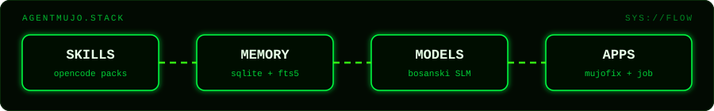

<div align="center">



[](https://github.com/xnet-ba)

[](https://github.com/xnet-ba?tab=repositories)
[](https://github.com/xnet-ba/mujofix)
[](https://github.com/xnet-ba/mujomemory)
[](https://github.com/xnet-ba/agentmujo-training)
[](https://github.com/xnet-ba?tab=repositories)

[](https://github.com/xnet-ba?tab=followers)


</div>

```yaml
org:         xnet-ba
mission:     open-source AI agenti iz BiH — lokalni, privatni, provjerljivi
focus:       [ AI agents, OpenCode skills, persistent memory, local SLM ]
location:    Sarajevo, BiH
stack:       Python · TypeScript · FastAPI · Next.js · SQLite · Ollama
flagship:
  mujofix:      AI mehanicar za Windows (open source)
  mujomemory:   persistent memory za OpenCode agente (Markdown + SQLite + FTS5)
  training:     fine-tuning malih bosanskojezicnih modela + function calling
  skills-hub:   AgentMujo Skills PACKs
daily:       "opencode + ollama + linux + hestia"
status:      "SYS://ONLINE — wake up, Neo"
```

<div align="center"></div>

<div align="center">

<a href="https://github.com/xnet-ba?tab=repositories"></a>

</div>

<div align="center"></div>

<div align="center">

<a href="https://github.com/xnet-ba/agentmujo-skills-hub"></a>


<br/>


</div>

<div align="center"></div>

<div align="center">


<br/>

<br/>


</div>

<div align="center"></div>

<div align="center">

### > flagship repos_

| Repo | Stars | Forks |
|---|---|---|
| [mujofix](https://github.com/xnet-ba/mujofix) — AI mehanicar za Windows |  |  |
| [mujomemory](https://github.com/xnet-ba/mujomemory) — persistent memory za AI agente |  |  |
| [agentmujo-training](https://github.com/xnet-ba/agentmujo-training) — fine-tuning malih bosanskih modela |  |  |
| [agentmujo-skills-hub](https://github.com/xnet-ba/agentmujo-skills-hub) — skills registry + pretraga |  |  |
| [agentmujo-skills-packs](https://github.com/xnet-ba/agentmujo-skills-packs) — 22 Skills PACKa |  |  |
| [AgentMujoJob](https://github.com/xnet-ba/AgentMujoJob) — AI asistent za pronalazak posla |  |  |

[](https://github.com/xnet-ba?tab=repositories)

<details>
<summary><b>&gt; svi public repoi_ (14)</b></summary>

- [agentmujo-git-auditor](https://github.com/xnet-ba/agentmujo-git-auditor) — nezavisni audit repozitorija (security, arhitektura, testovi, performanse)
- [agentmujo-mddr-shield](https://github.com/xnet-ba/agentmujo-mddr-shield) — operativni security-pack iz MDDR 2026 (4 skills, 2 CLI, MCP)
- [agentmujo-security-auditor](https://github.com/xnet-ba/agentmujo-security-auditor) — OWASP GenAI LLM Top 10 audit + fix-plan generator
- [ascii-motion-studio](https://github.com/xnet-ba/ascii-motion-studio) — ASCII image/video/animation generator
- [temporis-procurement-intelligence](https://github.com/xnet-ba/temporis-procurement-intelligence) — modularni AI ekosistem za javnu nabavu u RH
- [hestia-cp-skill](https://github.com/xnet-ba/hestia-cp-skill) — OpenCode skill za Hestia CP upravljanje
- [euact](https://github.com/xnet-ba/euact) — OpenCode skill za EU AI Act Article 4 (AI literacy)
- [mujopresa](https://github.com/xnet-ba/mujopresa) — eksperimentalni lossless kompresor (Python)

</details>

<picture>
  <source media="(prefers-color-scheme: dark)" srcset="https://raw.githubusercontent.com/xnet-ba/xnet-ba/output/snake-dark.svg"/>
  <source media="(prefers-color-scheme: light)" srcset="https://raw.githubusercontent.com/xnet-ba/xnet-ba/output/snake-light.svg"/>
  
</picture>


there is no spoon — only open source.

</div>
